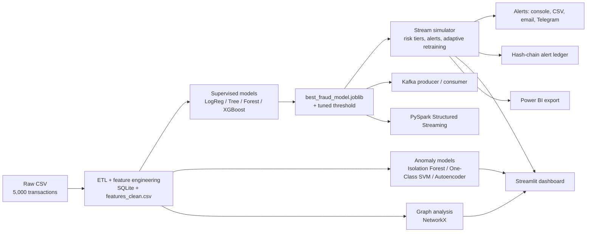
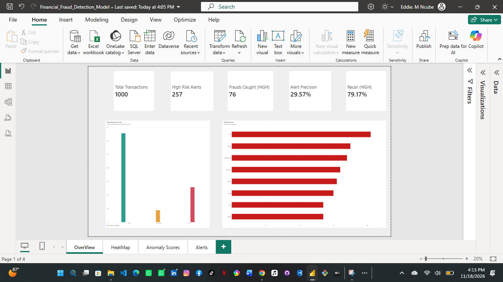
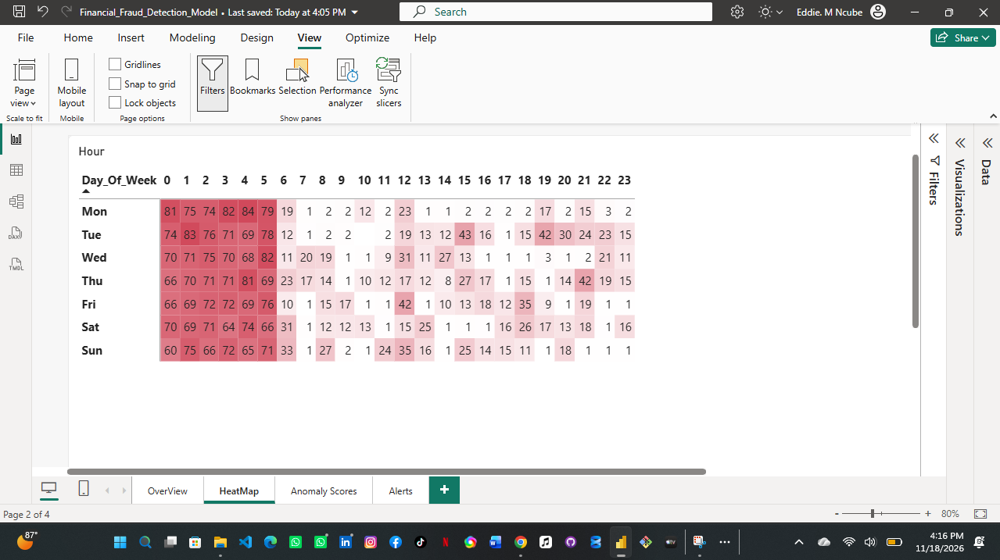
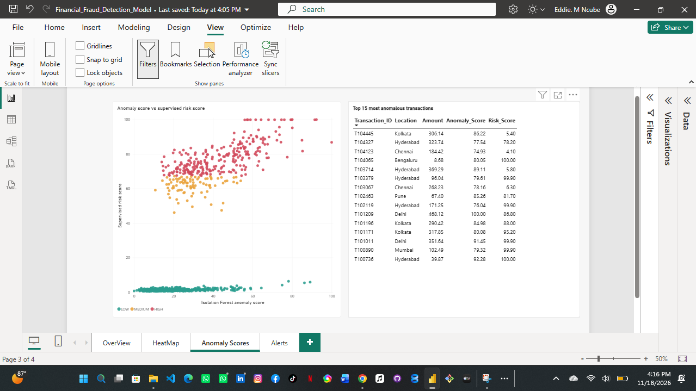
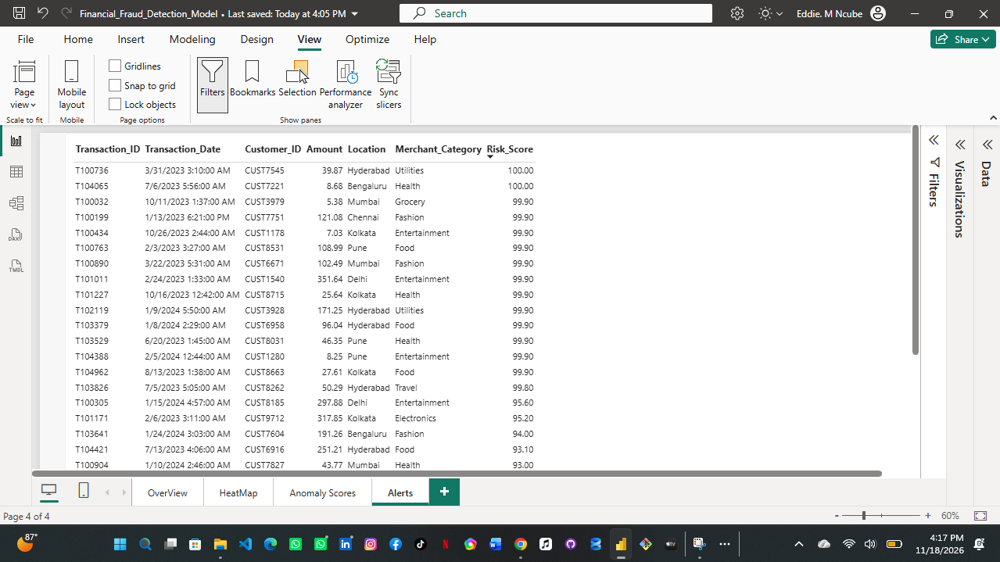

# Financial Fraud Detection Model with Dashboard

An end-to-end fraud analytics project: ETL, feature engineering, supervised and unsupervised
models, graph analysis, a real-time scoring pipeline (Kafka), alerting, an interactive Streamlit
dashboard and a four-page Power BI report.

**[Live dashboard](https://financial-fraud-detection-zz8tgrzhhmvy6bv5i2qimr.streamlit.app/)** | Power BI screenshots below

**Headline result:** on 1,000 held-out transactions (96 frauds), the model splits traffic into three
tiers. **65% of transactions are cleared as LOW risk with zero fraud among them**, and reviewing the
other 35% (MEDIUM + HIGH) catches all 96 frauds. Precision is limited (about 30% of HIGH alerts are
real fraud) because of noise in the dataset's labels; see [Limitations](#limitations).

## Architecture



## Dataset

5,000 card transactions, 14 columns (amount, merchant category, payment method, device, location,
international flag, customer history, suspicious keyword, fraud label). 482 frauds (9.64%), no
missing values, no duplicates, 3,847 distinct customers.

## What the data shows

| Pattern | Fraud rate |
|---|---|
| Transactions between **00:00 and 05:59** | 20-30% per hour (vs 3-5% for every other hour) |
| International | 37% (vs 7%) |
| Suspicious keyword | 47% (vs 7.6%) |
| **None** of those three flags | 1 fraud in 2,892 transactions |
| All three flags | 7 of 7 |

Flags stack: no flag is about 0%, one flag is 15-40%, two flags is 50-80%. Merchant category,
payment method, device, location, amount and account age carry almost no signal.

## Results

**Supervised (test set, 1,000 rows, 96 frauds)**

| Model | Precision | Recall | F1 | ROC-AUC | PR-AUC |
|---|---|---|---|---|---|
| Logistic Regression | 0.282 | 0.990 | 0.439 | 0.901 | 0.480 |
| Random Forest | 0.331 | 0.542 | 0.411 | 0.887 | 0.415 |
| Decision Tree | 0.278 | 0.969 | 0.432 | 0.883 | 0.362 |

(Precision/recall at threshold 0.5. Logistic Regression won on PR-AUC. At its cross-validated
threshold of 0.673: precision 0.305, recall 0.771, 74 frauds caught, 22 missed, 169 false alarms.)

**Unsupervised (no labels used for scoring)**

| Model | ROC-AUC | PR-AUC | Fraud caught in top 10% flagged |
|---|---|---|---|
| Isolation Forest | 0.844 | 0.377 | 45% (4.5x random) |
| Autoencoder | 0.784 | 0.370 | 42% |
| One-Class SVM | 0.727 | 0.267 | 38% |

**Live stream replay (1,000 held-out transactions in time order)**

| Risk tier | Transactions | Frauds | Fraud rate |
|---|---|---|---|
| LOW | 655 | 0 | 0% |
| MEDIUM | 88 | 20 | 23% |
| HIGH | 257 | 76 | 30% |

HIGH alone catches 76 of 96 frauds (79%). HIGH + MEDIUM catches 96 of 96 by reviewing 345 transactions.
The same logic running through **Kafka** (Docker, `apache/kafka`) scored 200 streamed messages
identically: 136 LOW (0 frauds), 17 MEDIUM, 47 HIGH.

The **PySpark Structured Streaming** job (Logistic Regression in Spark MLlib, 10 batch files of 100
transactions) reached a held-out ROC-AUC of 0.901 and PR-AUC of 0.488, matching the scikit-learn model.
At its fixed 0.70 alert threshold it raised 176 HIGH alerts and caught 61 of the 96 frauds
(63.5% recall, 34.7% precision). That is a stricter operating point than the tuned 0.673 threshold plus
MEDIUM tier used above, so the two are different trade-offs rather than a better or worse model.

**Customer risk profile:** 3,847 customers scored. LOW 2,304 (0.3% have a confirmed fraud),
MEDIUM 592 (24%), HIGH 951 (34%). 98.7% of customers with a confirmed fraud land in MEDIUM or HIGH.

## Power BI report

A four-page report built on the tidy CSVs from `export_powerbi.py` (the scored 1,000-transaction
stream, tier summaries and model tables). Headline numbers match the Streamlit dashboard:
1,000 transactions, 257 HIGH-risk alerts, 76 frauds caught by HIGH (79.17% recall, 29.57% alert precision).

**Overview**: KPI cards, transactions by risk tier, HIGH-risk alerts by merchant category.



**Heatmap**: fraud and alert intensity by hour of day and day of week (matrix with conditional formatting).
Fraud concentrates between 00:00 and 05:59.



**Anomaly scores**: unsupervised anomaly scores against the supervised risk score, one point per transaction.



**Alerts**: the 257 HIGH-risk transactions, ready for an analyst to work through.



DAX measures used:

```
Total Transactions  = COUNTROWS(fact_transactions)
High Risk Alerts    = SUM(fact_transactions[Is_High_Risk])
Total Frauds        = SUM(fact_transactions[Fraudulent])
Frauds Caught (HIGH)= SUM(fact_transactions[Caught_By_High])
Recall (HIGH)       = DIVIDE([Frauds Caught (HIGH)], [Total Frauds])
Alert Precision     = DIVIDE([Frauds Caught (HIGH)], [High Risk Alerts])
Avg Risk Score      = AVERAGE(fact_transactions[Risk_Score])
```

To rebuild it: run `python export_powerbi.py`, then in Power BI Desktop use **Get data → Text/CSV**
on the files in `powerbi_export/`. The `.pbix` file is not committed because it embeds a copy of the data.

## Project files

| File | Purpose |
|---|---|
| `main.py` | Step 1: load and explore the dataset |
| `etl_feature_eng.py` | Step 2: ETL into SQLite, cleaning, feature engineering |
| `diagnostics.py` | Step 3b: where does the fraud live (hour, flag combinations) |
| `supervised_models.py` | Step 3: Logistic Regression, Decision Tree, Random Forest, XGBoost/LightGBM, threshold tuning |
| `unsupervised.py` | Step 4: Isolation Forest, One-Class SVM, Autoencoder |
| `graph_analysis.py` | Step 5: repeat-customer test, entity graph, fraud co-occurrence network |
| `stream_simulator.py`, `alerts.py` | Step 6a: replay, risk tiers, alerts (console/CSV/email), adaptive retraining |
| `kafka_producer.py`, `kafka_consumer.py` | Step 6b: Kafka streaming |
| `spark_streaming.py` | Step 6b: PySpark Structured Streaming (prepare / train / stream) |
| `dashboard.py` | Step 7: Streamlit dashboard |
| `make_demo_data.py` | Step 9: builds `demo_data/` for the deployed dashboard |
| `export_powerbi.py` | Step 7: tidy CSVs for Power BI |
| `screenshots/` | Power BI report page images used in this README |
| `customer_risk.py` | Step 8: customer fraud-risk profile |
| `hashchain_log.py` | Step 8: tamper-evident alert ledger |
| `telegram_alerts.py` | Step 8: mobile alerts through a Telegram bot |

## How to run

```powershell
python -m pip install -r requirements-pipeline.txt   # full pipeline (requirements.txt is dashboard-only, see Deployment)

python main.py                       # explore
python etl_feature_eng.py            # creates fraud_detection.db and features_clean.csv
python supervised_models.py          # creates best_fraud_model.joblib
python unsupervised.py
python graph_analysis.py
python stream_simulator.py           # creates stream_scores.csv and alerts_log.csv
python export_powerbi.py             # creates powerbi_export/
python customer_risk.py
python hashchain_log.py build        # then: verify, demo
python -m streamlit run dashboard.py
```

**Kafka (optional, needs Docker Desktop):**

```powershell
docker run -d --name kafka -p 9092:9092 apache/kafka:latest
python kafka_consumer.py                            # terminal 1
python kafka_producer.py --limit 200                # terminal 2
```

**Spark (optional, needs Java 17 and `pip install pyspark`):**
`python spark_streaming.py prepare`, then `train`, then `stream`.

Windows notes (from the actual setup): PySpark may not support the newest Python, so use a separate
Python 3.11 virtual environment (`py -3.11 -m venv .venv-spark`). Spark's Hadoop layer also needs
`winutils.exe` and `hadoop.dll` in `C:\hadoop\bin` (community builds, for example from
`github.com/cdarlint/winutils`; only download them from the repository page itself). Set
`$env:HADOOP_HOME="C:\hadoop"` and add `C:\hadoop\bin` to `Path` in the terminal before running.
Without them, saving the model fails with `HADOOP_HOME and hadoop.home.dir are unset`. The PyArrow and
pandas 3.0 warnings are harmless.

**Email and Telegram alerts** are off by default and read credentials from environment variables
(`ALERT_SENDER`, `ALERT_APP_PASSWORD`, `ALERT_RECIPIENT`, `TELEGRAM_BOT_TOKEN`, `TELEGRAM_CHAT_ID`).
Never commit tokens or passwords.

## Deployment (Streamlit Community Cloud)

The dashboard is deployed from this repo. Generated files are git-ignored, so the deployed app
reads a small committed `demo_data/` folder instead (scored stream, anomaly scores, model tables,
the trained model and a tiny defaults file for the "Score a transaction" tab; no raw dataset).

```powershell
python make_demo_data.py     # builds demo_data/ and a dashboard-only requirements.txt
python -m streamlit run dashboard.py   # test locally, it falls back to demo_data/ when files are missing
```

`requirements.txt` holds only the dashboard packages, pinned to the versions the model was trained with
(a scikit-learn version mismatch can break loading the saved model). The full pipeline needs
`requirements-pipeline.txt`. Live app:[financial-fraud-detection.streamlit.app](https://financial-fraud-detection-zz8tgrzhhmvy6bv5i2qimr.streamlit.app/)

## Design decisions

- **No data leakage.** Scaling and encoding live inside a pipeline fitted on training data only; the
  decision threshold is chosen by cross-validation on training data, not on the test set.
- **Imbalance handled with class weights** instead of resampling. Accuracy is not reported: predicting
  "never fraud" is already 90% accurate. PR-AUC and recall matter here.
- **Risk tiers instead of one hard cut.** A bank picks the thresholds from the cost of a missed fraud
  against the cost of reviewing a false alert.
- **Autoencoder** is built with scikit-learn's `MLPRegressor` (no TensorFlow dependency); a Keras
  version is a drop-in replacement for the same bottleneck design.

## Limitations

Please read these before drawing conclusions from the numbers.

1. **The dataset looks synthetic.** Fraud is driven by three flags plus noise, and a simple Logistic
   Regression beat the tree ensembles. Real fraud data is messier and usually needs far more feature
   work.
2. **Precision is capped by label noise.** About 70% of HIGH alerts are legitimate transactions, and
   nothing in the data separates them from the frauds. More algorithms do not fix that.
3. **Small test set.** Only 96 frauds, so recall figures can swing by several points between splits.
4. **Graph analysis found no fraud rings.** The data has no shared devices, IPs or accounts. Customer
   fraud history was not predictive (10 customers with 2+ frauds, 12.4 expected by chance). The graph
   exports are ready for real link data.
5. **Adaptive learning is implemented but not demonstrated.** The fraud pattern here does not change
   over time, so retraining on feedback made no difference (PR-AUC 0.477 adaptive vs 0.480 static).
   Its value appears under concept drift.
6. **Customer risk is not credit scoring.** There is no repayment or income data. It is a fraud-exposure
   profile that could feed a credit model later.
7. **The hash-chain ledger is tamper-evident, not a blockchain.** It detects edits to a local log;
   there is no distributed consensus.
8. **The Spark job trains its own model** with a smaller feature set and a fixed 0.70 threshold, so
   its alert counts are not directly comparable to the scikit-learn tiers (its AUC values are).
   It also ran on Hadoop 3.5.0 with community-built Windows helper files from Hadoop 3.3.6, which
   worked here but is not an officially supported combination.

## Future work

Real link data for fraud-ring detection; drift simulation and monitoring; cost-based threshold
selection; Keras autoencoder; credit-risk modelling with repayment data; hooking Telegram into the
stream; a multi-node ledger.
